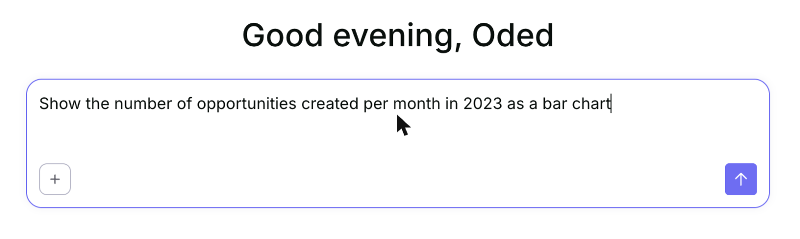
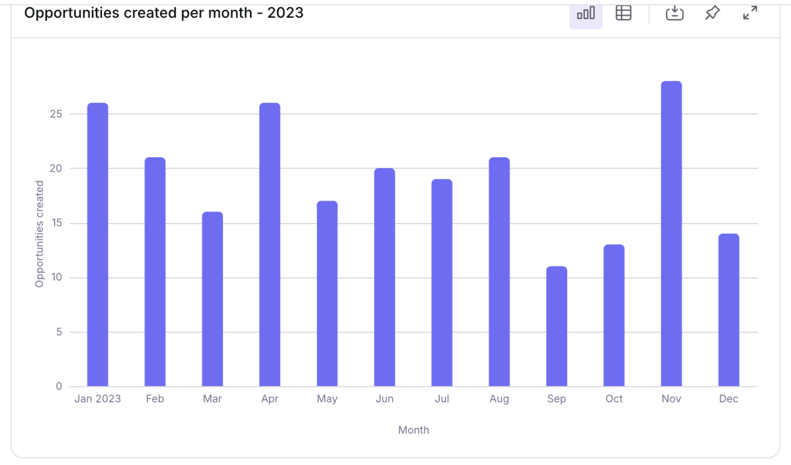
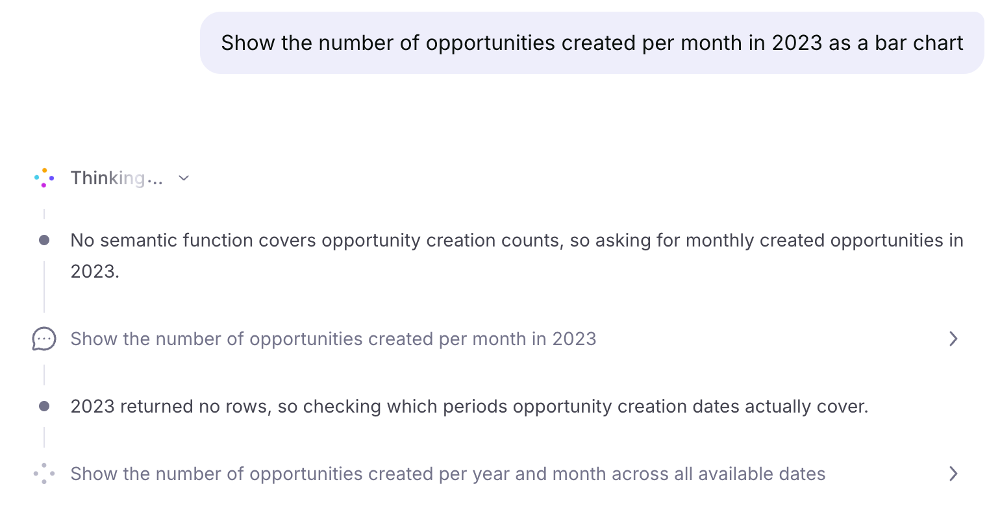
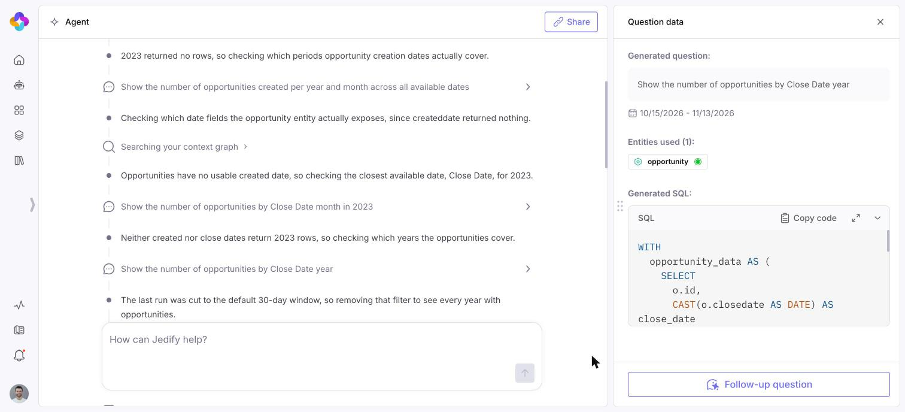

Agent mode is a conversational way to work with Jedify. Ask a question in plain language, and the agent picks the data it needs, runs the queries, and answers with text, charts, and tables. It also suggests what to look at next, so you can keep going with follow-up questions.

## Choose a mode

In the prompt box on the **Home** page, open the mode menu and pick a mode:

| Mode | Use it for |
| --- | --- |
| **Agent** | Conversations, follow-ups, and tailored results with charts |
| **Analyst** | Structured analysis for focused answers |
| **Research** | Deeper multi-step investigation. See [Research Agent](/using-jedify/deep-research-agent). |

Agent mode is the default. To move an existing conversation to Agent mode, start a new session.

## Give the agent a task

Give your agent a task just as you would a colleague. For example:

1. "Analyze monthly revenue trends for this year".
2. "Which customers grew the most last quarter? Show it as a bar chart".
3. "Compare marketing spend with pipeline generated, by campaign".

Then keep the conversation going: "Break that down by region", "Only enterprise accounts", "Why did March drop?".

## What you get in an answer

1. **Charts and tables in the answer.** Ask for the chart you want, for example a line, bar, pie, map, or a single KPI number, and set colors ("show EMEA in green"). You can switch each visual between a chart and a table.
2. **Suggested next steps.** Answers end with a few ideas for what to ask next.
3. **Data from several sources.** The agent sends each part of your question to the data source that holds it, and can combine the results into one table.
4. **Public facts from the web.** When a public fact helps (for example an exchange rate), the agent can search the web and labels that information separately from your company's data. To turn web search off for your account, contact the Jedify team.

## See how the agent worked

While the agent works, its steps appear under **Thinking**. When it finishes, they fold under **Completed**. Click to open them again.

Open any step to see the question the agent asked, the entities it used, the SQL it ran (or the API calls, for API sources), and the data it got back. Click **Follow-up question** to ask more about that step.

## Work with results

From an answer you can:

1. **Download** the data as CSV, or a chart as PNG.
2. **Pin to Home** to add it to your [Home dashboard](/using-jedify/homepage-dashboard). Keep the original time window, or switch to a relative timeframe such as "last 30 days".
3. **Expand** a visual to full view.
4. **Share** the conversation.
5. Rate the answer with a thumbs up or down.

## Pick up past work

The agent knows your five most recent conversations. To find older work, ask it, for example: "Search my past sessions for anything about ARR".

## Semantic functions

The agent uses your account's existing semantic functions to answer common questions quickly.

Admins and Data Experts can also ask the agent to create a semantic function from a good answer, or to update an existing one. The agent may suggest saving a question you ask often, but it saves only after you say yes.

## Your account's rules apply

Agent mode follows the same [Answer Guidance](/semantic-fusion/statements/answer-guidance) and [Time Analysis](/semantic-fusion/statements/time-analysis) settings as Analyst mode.

## Make the agent yours

<CardGroup cols={2}>
  <Card title="Skills" icon="list-check" href="/using-jedify/skills">
    Save a way of answering so the agent follows it every time.
  </Card>

  <Card title="Personal memory" icon="brain" href="/using-jedify/personal-memory">
    Tell the agent your preferences once. It remembers them.
  </Card>
</CardGroup>
