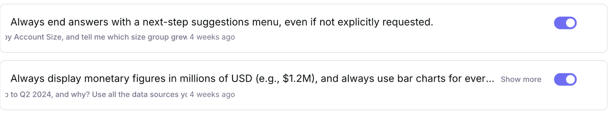

Personal memory saves your standing preferences, such as what a term means to you or how you like your charts, and applies them in every new [Agent mode](/using-jedify/agent-mode) conversation. You explain something once, not every time.

## What Jedify remembers

Jedify saves preferences you want applied from now on, for example:

1. **Definitions:** "When I say regions, I mean countries".
2. **Defaults:** "Always show revenue in USD." or "By default, exclude test accounts".
3. **Chart styles:** "I prefer EMEA in green".

A request for one answer only, such as "show last quarter", applies to that answer and isn't saved.

## How a memory is saved

You don't need to say "remember this." When you state a standing preference (a definition, or words like "always", "by default", "from now on", or "I prefer"), Jedify saves it and applies it to the current answer. The last line of the answer confirms it:

> Saved to memory: I'll read "regions" as countries from now on.

You can also change a memory in the conversation:

| You say | Jedify replies |
| --- | --- |
| "Actually, regions means sales regions." | Updated memory: "regions" now means sales regions (was countries). |
| "Forget what I said about regions." | Forgotten: "regions" means countries. It's paused in Settings > Memory if you want it back. |

## Manage your memories

### "Settings" page

Go to **Settings** > **Memory**. From there you can:

1. **Search** your memories, or filter by active and paused.
2. **Pause or resume** a memory with its toggle. Jedify ignores paused memories.
3. **Edit or delete** a memory from its menu.
4. **Open the conversation** where the memory was saved, using the **From** link.

### Chat

Simply ask the agent to pause the memory.

## Privacy

Your memories belong to you. Teammates can't see them, and they don't change anyone else's answers.

## Good to know

1. **Limits:** By default you can have up to 20 active memories, each up to 500 characters. Paused memories don't count. To add more, pause or delete one.
2. **Where it works:** Memory works in Agent mode. Analyst mode, Research mode, and Data Agents don't save or use memories.
3. **What wins:** What you ask in your current message overrides a memory. Your account's [Answer Guidance](/semantic-fusion/statements/answer-guidance) also overrides a memory that disagrees with it.
