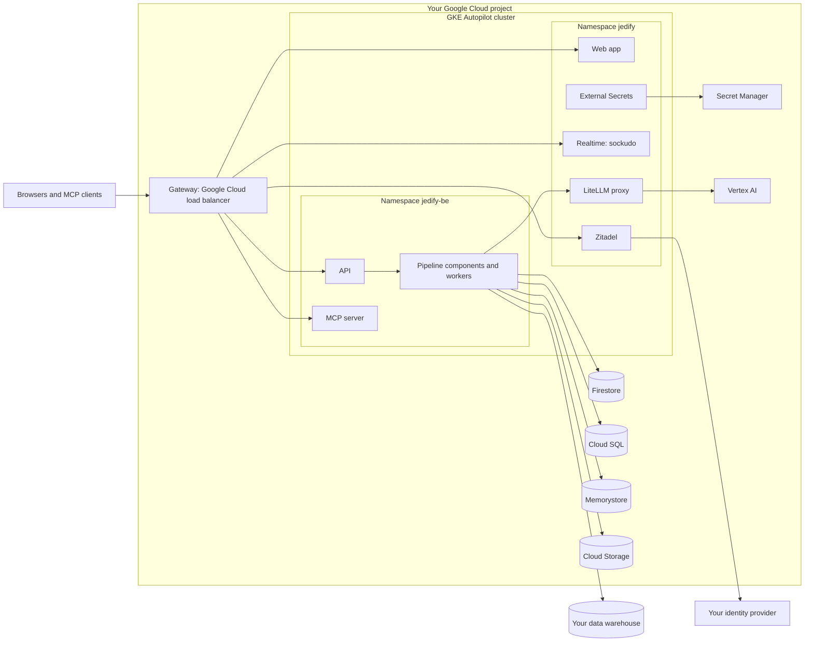

A self-hosted installation runs the whole Jedify platform inside a Google Cloud project you own. OpenTofu (or Terraform) creates the cloud resources, two Helm charts install the platform services and the application, and a setup script configures sign-in against your own identity provider.

No component uses a service-account key. Every workload authenticates as a Google service account through Workload Identity. The one stored credential is the Cloud SQL password: OpenTofu generates it, writes it straight into Secret Manager, and never prints it.

<Note>
This section documents release **2026.10.10**. Commands and values refer to that release unless a page says otherwise.
</Note>

## Architecture

Everything runs in one GKE Autopilot cluster, in two namespaces:

| Namespace | Installed by | What runs there |
| --- | --- | --- |
| `jedify` | the `jedify-infra` chart | External Secrets, the LiteLLM proxy, sockudo (realtime), Zitadel (identity), the web app, Reloader, and the Gateway |
| `jedify-be` | the `jedify-be` chart, installed twice | the API, the MCP server, the pipeline components, a code-execution sandbox, the queue workers, and periodic CronJobs |

### Google Cloud services

| Service | What Jedify uses it for |
| --- | --- |
| GKE Autopilot | Runs every workload. Google manages the nodes, so there are no node pools to size or patch. |
| Firestore, Enterprise edition, MongoDB-compatible | The application's database. The application speaks MongoDB through a standard driver. |
| Cloud SQL for PostgreSQL 16 | Two application databases (`grounding_index` and `jedify_queues`) and Zitadel's own database. |
| Memorystore for Redis 7.2, or Memorystore for Valkey 8.0 with Private Service Connect | Cache and queue state, and the shared state that lets the two realtime replicas fan out events. |
| Cloud Storage | Uploads, trained models and generated artifacts, in one bucket. |
| Secret Manager | The application's configuration and every generated credential. |
| Artifact Registry | The images your cluster pulls. |
| Vertex AI | The models, by default. |
| Cloud Load Balancing, Cloud NAT, Cloud DNS | The Gateway, egress to the internet, and private DNS zones that keep Google API traffic inside Google's network. |

## How requests reach the platform

One hostname serves the web app, the API, the MCP server and realtime. The Gateway routes by path:

| Path on the application host | Served by |
| --- | --- |
| `/api`, `/docs`, `/openapi.json`, `/.well-known` | The API |
| `/mcp`, `/authorize`, `/token`, `/register`, `/revoke`, `/consent`, `/auth/callback`, `/.well-known/oauth-authorization-server`, `/.well-known/oauth-protected-resource` | The MCP server |
| `/pusher` | Realtime (sockudo), with the prefix removed |
| Everything else | The web app |

Zitadel is served on a second hostname of its own. Because the web app and the API share one origin, the browser's calls from the web app to the API are same-origin requests.

The Gateway is GKE's own Gateway API implementation, so the installation ships no ingress proxy. By default it creates an **internal** regional load balancer, reachable only from inside your network. See [DNS and TLS](/self-hosted/requirements#dns-and-tls) for the other choices.

## How sign-in works

Zitadel is the identity layer built into the installation. It federates to your own OIDC identity provider (Okta, Microsoft Entra ID, Google and others), so your users sign in with their existing accounts.

1. A user opens the web app and is sent to Zitadel's sign-in page, which only accepts users of your organization.
2. The user chooses your identity provider's button and signs in there. Your provider redirects the browser back to Zitadel, and Zitadel completes the exchange with your provider **from inside the cluster**.
3. The first time a person signs in, Zitadel creates their user (or links them by email to a user that already exists). They see nothing in Jedify until you give them a role.
4. Zitadel issues a token to the web app. The API verifies it against Zitadel's public keys and reads the user's roles from Zitadel's management API, inside the cluster.

The MCP server is a second sign-in client. AI agents and other MCP clients authorize through the MCP server's OAuth endpoints on the application host, which hand off to Zitadel. See [Identity and sign-in](/self-hosted/identity).

## How model calls flow

The application never calls a model provider directly. Every model call goes to the LiteLLM proxy in the `jedify` namespace. The proxy runs as its own Google service account, which holds one role, `roles/aiplatform.user`, and calls Vertex AI over Private Google Access.

The application asks for models by fixed names. The proxy maps each name to a Vertex AI model, so changing models is a values change, not an image change. You can also replace the bundled proxy with an OpenAI-compatible gateway you already run. See [Model gateway](/self-hosted/model-gateway).

## Identities and permissions

OpenTofu creates three Google service accounts. Each Kubernetes ServiceAccount is bound to one of them through Workload Identity.

| Google service account | Kubernetes ServiceAccount | Roles |
| --- | --- | --- |
| `<prefix>-app` | `jedify-be/jedify-be` | `roles/datastore.user` and `roles/datastore.indexAdmin` on the project, `roles/aiplatform.user`, `roles/artifactregistry.reader`, and `roles/storage.objectAdmin` on the application bucket only |
| `<prefix>-eso` | `jedify/external-secrets` | `roles/secretmanager.secretAccessor` on the project |
| `<prefix>-litellm` | `jedify/litellm` | `roles/aiplatform.user`, and nothing else |

<Warning>
Workload Identity bindings name a namespace and a ServiceAccount **literally**. If you install a chart into a different namespace, or rename a ServiceAccount, without changing the matching OpenTofu variable, every pod comes up healthy and every Google API call fails with a permission error that names neither side of the mismatch. Keep the defaults unless you change both sides together.
</Warning>

Firestore has no per-database data role, so `roles/datastore.user` reaches every Firestore database in the project. That's why the installation expects a project of its own.

## Two roles

The install splits into two halves. One person or team can do both, but the split tells you which half to check when something fails.

| | Role A: supplies images and secrets | Role B: applies the infrastructure and installs the charts |
| --- | --- | --- |
| Does | Copies the release images into your Artifact Registry. Creates the Secret Manager objects that hold the application's configuration. Registers Jedify with your identity provider. | Runs OpenTofu, installs both charts, and runs the Zitadel setup script. |
| Nature | Manual. It needs credentials, registry access and decisions about your identity provider. | Reproducible from the release bundle. |

Role B can't verify Role A's half. Helm can check that a Secret Manager object has been **named**, never that it exists or holds the right keys. So each missing piece fails in a known way:

| What's missing | How it shows up |
| --- | --- |
| An image | `ImagePullBackOff` on every pod that uses it |
| A Secret Manager object | The `app-secrets` ExternalSecret isn't ready, and pods stay in `CreateContainerConfigError` |
| A key inside that object | The pod starts and crashes, or starts and can't serve. See the [secrets reference](/self-hosted/reference/secrets). |

## Release artifacts and versioning

Jedify publishes each release to a private release registry in Google Artifact Registry and grants read access to a Google identity you name. One release is six artifacts under one version:

| Artifact | Contents |
| --- | --- |
| `bundles/jedify-deploy:<version>` | An OCI artifact holding `jedify-deploy-<version>.tar.gz`: the install guide, the values templates (`values/`), the OpenTofu configuration (`terraform/`) and the Zitadel setup script (`scripts/zitadel-setup.sh`) |
| `charts/jedify-infra:<version>` | The platform chart, with every dependency chart bundled inside it, so installing it needs no chart repository |
| `charts/jedify-be:<version>` | The application chart |
| `jedify-be:<version>` | The application image |
| `jedify-sandbox:<version>` | The code-execution sandbox image, built together with the application image |
| `jedify-fe:<version>` | The web app image |

Versions are calendar versions: `<year>.<month>.<release within the month>`, with no leading zero (October 2026's tenth release is `2026.10.10`). A version names a set of charts and images tested together. It makes no compatibility promise, so read [Upgrades](/self-hosted/upgrades) before moving between versions, and always move every artifact to the same version.

From 2026.10.2, every image is published for both `arm64` and `amd64`. Releases 2026.10.1 and earlier publish Jedify's own images for `arm64` only.

## What a self-hosted installation doesn't support

- **Context Graph Versioning.** The git-backed version history of the Context Graph reaches its repositories through an Amazon S3 transport, which a Google Cloud installation doesn't have. The rest of the application runs without it, and only that feature's route returns an error, about a missing bucket name. See [Context Graph Versioning](/semantic-fusion/versioning/overview).
- **Sorting the semantic dimensions list by name.** Firestore doesn't support MongoDB collations, so that one sort returns an error. Every other sort works.

## Next steps

<CardGroup cols={2}>
  <Card title="Requirements" icon="list-check" href="/self-hosted/requirements">
    Project, permissions, network, DNS and TLS.
  </Card>
  <Card title="Install" icon="download" href="/self-hosted/install">
    OpenTofu, both charts and the Zitadel setup, step by step.
  </Card>
  <Card title="Identity and sign-in" icon="id-badge" href="/self-hosted/identity">
    Connect your identity provider and grant roles.
  </Card>
  <Card title="Troubleshooting" icon="bug" href="/self-hosted/troubleshooting">
    Symptoms, causes and fixes.
  </Card>
</CardGroup>
