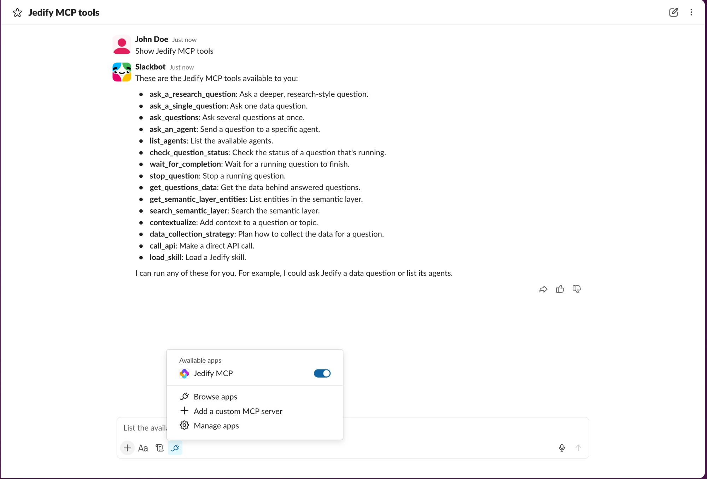

Slackbot, Slack's built-in assistant, can use Jedify to answer your data questions. You ask Slackbot in plain language, and it calls Jedify for the answer.

## Before you start

- Your workspace is connected to Jedify. See [Installation](/settings/slack/installation).
- Your Slack email matches your Jedify user. Jedify uses it to know who is asking.
- If your workspace connected Jedify before Slackbot support, an admin reconnects once: in **Integrations**, click **Connect to Slack** again and approve the new permission.

## Turn on Jedify in Slackbot

1. Open Slackbot.
2. In the message box, click the apps button.
3. Under **Available apps**, turn on **Jedify MCP**.

Then ask your question, for example: `What was revenue last month by region?`

## What Slackbot can do with Jedify

Slackbot can:

- Ask Jedify a data question, several questions at once, or a deeper research question
- Ask one of your Jedify agents, or list the agents you can use
- Search your semantic layer and list its entities
- Check on a question that is still running, or stop it

To see the full list, ask Slackbot: `Show Jedify MCP tools`.

## Permissions

Slackbot answers with **your own** Jedify user and data permissions, the same as when you ask Jedify directly. It never sees data your Jedify user can't access.

## Slackbot or @Jedify?

| | Slackbot | @Jedify |
|---|---|---|
| Where you ask | Your Slackbot conversation | Jedify's DM, or a channel or thread where you mention it |
| Who replies | Slackbot, using Jedify's answer | Jedify, with live progress, clarifying questions, and feedback buttons |
| Good for | Quick questions alongside the rest of your Slackbot work | Analysis you share with your team, and follow-ups in a thread |

## Troubleshooting

- **"Jedify could not match your Slack account to a Jedify user"**: check that your workspace is connected to Jedify and that your Slack email matches your Jedify user.
- **Jedify MCP is not under Available apps**: your workspace may have connected before Slackbot support. Ask an admin to reconnect from **Integrations**.
- **An answer takes a while**: questions usually take longer than a minute. Slackbot keeps checking until the answer is ready.
- **"Your Jedify user is disabled"** or **"Your Jedify account is disabled"**: contact your Jedify admin.
