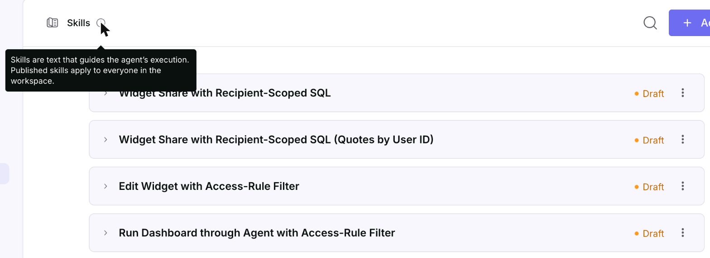
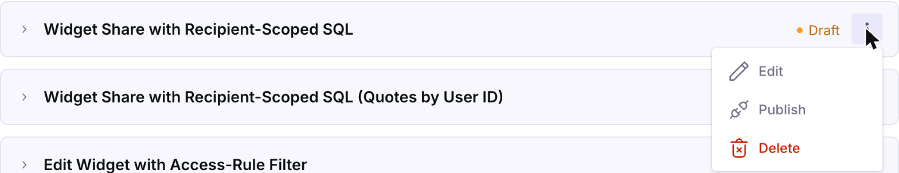
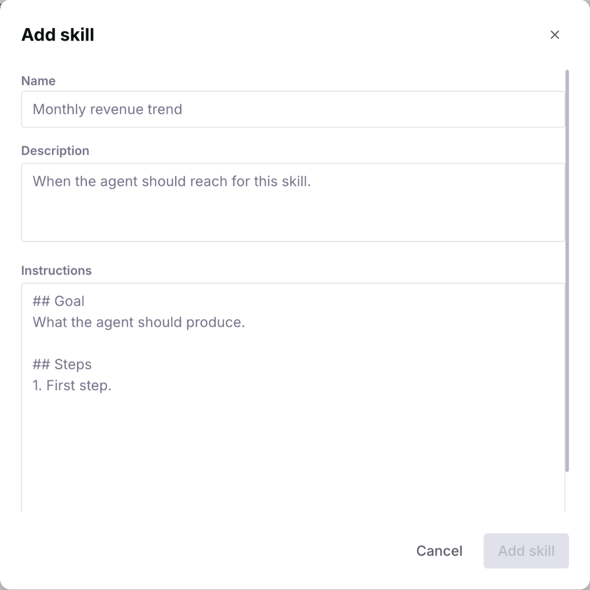

A skill is a short set of instructions that tells the agent how to handle a type of request. For example, a skill can describe how your Finance team wants the monthly revenue trend built: which metric, which filters, which chart. When a matching question comes in, the agent follows the skill, so everyone gets the answer the same way.

Skills work in [Agent mode](/using-jedify/agent-mode).

## What a skill contains

| Field | What to write |
| --- | --- |
| **Name** | A short name, for example "Monthly revenue trend". Up to 80 characters. |
| **Description** | When the agent should use the skill, for example "Use when someone asks for revenue by month." Up to 500 characters. |
| **Instructions** | The steps and rules to follow, in plain text or markdown. |

The agent reads each skill's description to decide whether it fits your request. When it does, the agent loads the skill before answering and treats it as its top priority for the rest of the conversation.

## Create a skill

### From a conversation

1. In Agent mode, work with the agent until you get the answer you want.
2. Ask: "Save this as a skill".

The agent creates the skill as a draft that only you can see. You can use it right away in the same conversation. Anyone can create skills this way.

### From Settings (admins)

1. Go to **Settings** > **Skills**.
2. Click **Add skill**.
3. Fill in **Name**, **Description**, and **Instructions**, then save.

## Draft and published skills

Every new skill starts as a draft.

| Status | Who can use it |
| --- | --- |
| **Draft** | Only you |
| **Published** | Everyone in your workspace |

When your draft works the way you want, publish it:

1. In **Settings** > **Skills**, open the skill's menu and select **Publish**, or
2. Ask the agent: "Publish the Monthly revenue trend skill".

To take a skill back to draft, select **Unpublish**.

<Note>
  Only the person who created a skill can edit, publish, unpublish, or delete it.
</Note>

## Use a skill

1. **Automatically.** Ask your question as usual. If it matches a skill, the agent uses it.
2. **Pick it yourself.** Type `/` in the Agent mode prompt box and choose a skill from the list. You can add up to five skills to one message.
3. **By name.** Ask: "Use the Monthly revenue trend skill".

If a skill is unpublished or deleted, the agent stops using it, including in earlier conversations.

## Manage skills

Go to **Settings** > **Skills** to see all the skills you can use. From there you can:

1. Search your skills.
2. See each skill's status and how many times it was used.
3. Edit, publish, unpublish, or delete the skills you created.

## Use skills from Claude and other AI tools

When you connect to Jedify through [MCP](/mcp/overview), your AI tool can see the skills available to you and load one when your request matches. Create and publish skills in Jedify.

## Tips for good skills

1. **Say when in the description.** The agent uses the description to decide when to apply the skill. Start with "Use when…".
2. **Keep each skill to one job.** Two small skills work better than one skill that covers everything.
3. **Be specific.** Name the metric, the filters, the time range, and the chart you expect.
4. **Test before you publish.** Try the draft on a few real questions, then publish it.
